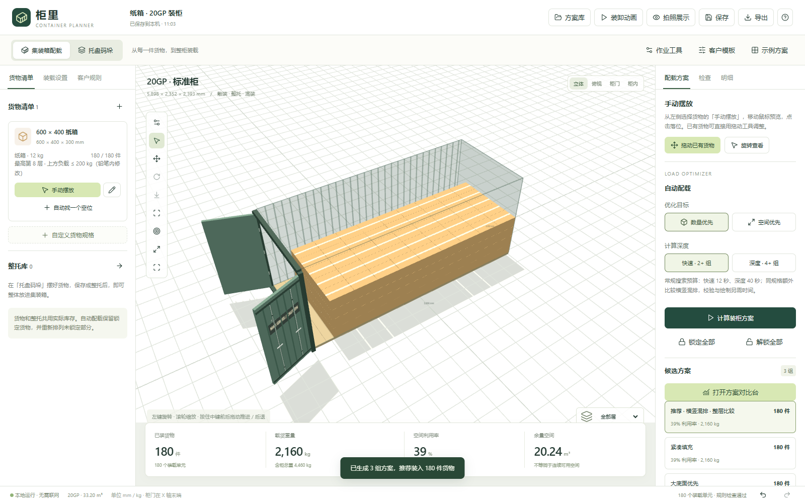
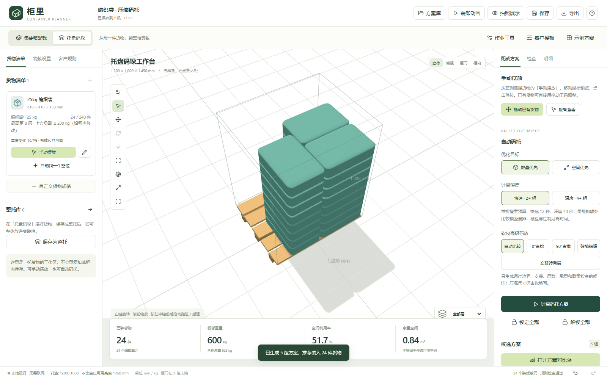
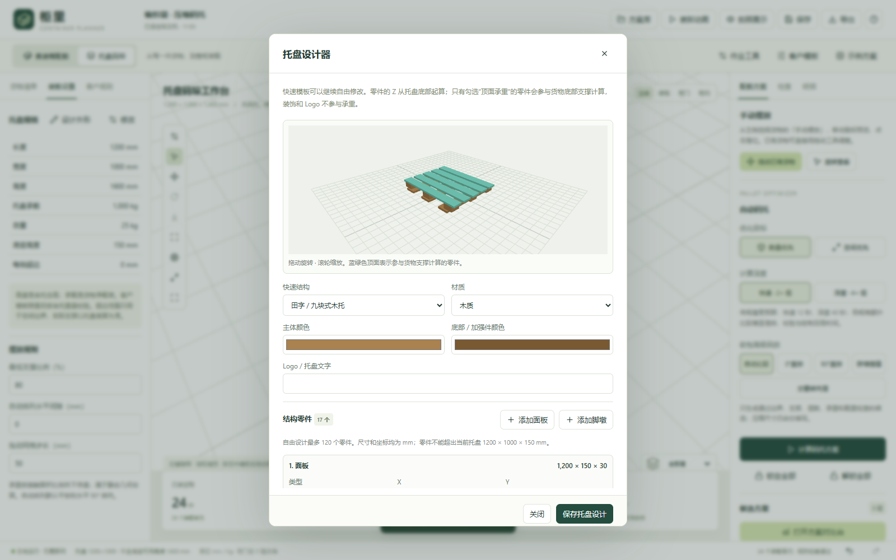
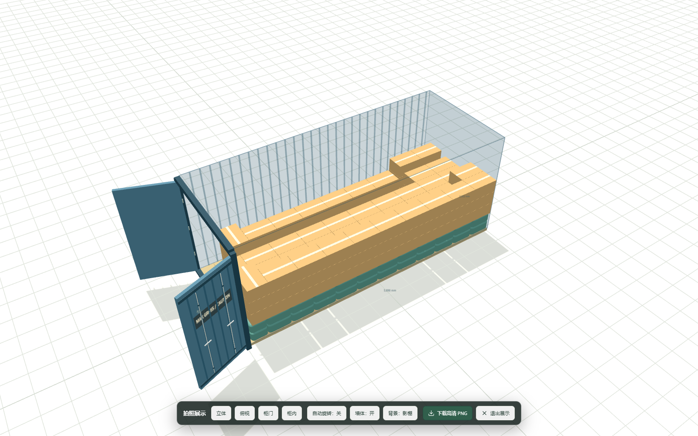

# 柜里 Container Planner

一个面向集装箱、托盘、纸箱和软包/编织袋的本地 3D 装载规划工具。它把自动配载、手动摆放、码托、重量校验、风险提示、装卸演示和报告导出放在同一个浏览器界面中。

项目可离线运行，不需要账号或云服务。方案默认只保存在本机，不会自动上传。它曾用于实际订单的装载测算参考，但不替代现场试装、包装测试、叉车作业评估或运输安全验收。

## 写在前面

> 诸位做外贸的同僚：
>
> 相信不少朋友都被装柜计算折磨过。货物尺寸、数量、重量、托盘和摆放方式，往往需要在纸面上反复计算、规划，给客户展示时也不够直观。
>
> 我自己也遇到了这些问题，所以借助 Codex 制作了这款工具——「柜里」。目前，它已经投入我的实际订单中使用。通过 3D 模型和尺寸、重量、摆放规则的计算，可以更直观地查看装柜效果、调整方案，也方便与客户沟通。计算结果仍需结合实际包装和现场情况复核。
>
> 现在，我把这个系统公开分享出来，希望能帮到诸位。也欢迎大家提出修改意见、反馈使用中遇到的问题，让我和这个软件一起进步。
>
> 此外，请尊重我投入的时间和 Token。欢迎在公司内部分享和使用，请保留作者姓名及项目来源；也欢迎直接分享仓库链接。未经许可，请勿去除署名、搬运冒充原创、二次打包公开发布或售卖。
>
> 最后，希望它能让大家少画几张草图，少算几遍尺寸，多一点准时下班的机会。
>
> —— 项目作者

## 效果预览

<table>
  <tr>
    <td width="50%">
      
      <br><strong>自动装柜</strong>：计算候选阵列，并同步显示件数、重量、空间利用率和剩余空间。
    </td>
    <td width="50%">
      
      <br><strong>软包码托</strong>：根据有效尺寸、压缩量、层数、支撑和承重计算托盘阵列。
    </td>
  </tr>
  <tr>
    <td width="50%">
      
      <br><strong>托盘设计器</strong>：选择预设结构，或自由调整面板、横梁、脚墩、材质、颜色和文字。
    </td>
    <td width="50%">
      
      <br><strong>拍照展示</strong>：用纯净 3D 视图展示混装结果、柜门模型和集装箱皮肤。
    </td>
  </tr>
</table>

## 核心能力

### 集装箱与托盘

- 内置 20GP、40GP、40HC，可自定义柜内尺寸、柜门尺寸、载货上限和柜体自重。
- 内置 1200×1000、1200×800、1100×1100 mm 托盘，可自定义底座高度、含托总高、载重、自重和允许超边。
- 独立托盘码垛工作区；整托可保存到整托库、组合入柜、复制编辑或解散为散件。
- 托盘设计器支持田字、川字、九脚塑料、网格塑料、钢托和自由结构，可调整零件、材质、颜色、文字与 Logo。

### 货物与软包

- 支持纸箱、软包和编织袋，可设置原始尺寸、有效尺寸、单件毛重、库存、堆叠层数、上方载荷、批次和装卸顺序。
- 新建或编辑规格时提供 3D 实时预览；袋子可人工设置压缩比例或压缩后尺寸，压缩不改变重量。
- 允许水平旋转，并可比较直排、90°直排、砖墙错缝和交替转向层等软包码放方式。
- 可编辑货物颜色、材质、条带、网格、标签面、SKU、向上箭头和 Logo。

### 自动配载与手动编辑

- 支持“数量优先”或“空间利用率优先”，提供快速/深度搜索和候选方案对比。
- 自动计算遵守库存、边界、碰撞、柜门通过性、支撑、承重、最高层数、托盘超边和总重量限制。
- 自动计算保留锁定货物，只重排未锁定部分；可在现有布局上继续补位。
- 支持单件点放、拖动、任意水平角度、精确坐标、落面、复制、阵列、锁定、撤销和重做。
- 支持框选、多选、组移动、对齐、等距排列、复制整层，以及二维俯视/侧视编辑。
- “短暂重叠”只用于整理草稿，最终校验不会绕过碰撞、边界、重量、支撑或柜门限制。

### 检查、分析与演示

- 实时统计货物件数、装载单元数、货物重量、含柜/托总重、有效体积利用率、剩余体积和货物重心。
- 显示大面积空余区域，并解释未装完的常见原因，如载重、库存、时间预算、单元上限、尺寸、支撑或承重限制。
- 提供单件重量、下层承压、底部支撑和综合风险热力图。
- 柜门可点击开合并执行扫掠碰撞检查；浏览视角支持中键推进/后退。
- 几何装卸路径动画可检查固定朝向下的直进、直退和抬升过程。
- 拍照展示模式可隐藏编辑界面、切换视角、自动旋转并导出高清 PNG。
- 集装箱皮肤支持预设颜色、自定义主色、贴花、柜号、警示文字、Logo 和视觉磨损。

### 方案、规则与导出

- 本地自动保存、上一版备份、方案库、命名历史版本、另存副本、撤销/重做。
- JSON 导入导出、CSV 明细、Excel/CSV 货物批量导入、3D PNG 和中英文离线 HTML 报告。
- 多柜分配和运费比较，可组合不同柜型并明确显示剩余库存。
- 现场装柜核对支持实装数量、柜号、封条号、核对人、差异原因和照片记录。
- 客户/商超规则库支持来源、版本、有效期、托盘、限高限重、混托和标签要求。内置名称仅作分类入口，不代表商超官方规则或认证。

## 快速开始

### 从源码运行

环境要求：

- Node.js `20.19+` 或 `22.12+`
- Windows、macOS 或 Linux 的现代 Edge/Chrome 浏览器

```powershell
git clone https://github.com/AmBiTTion/container-planner.git
cd container-planner
npm ci
npm run build
npm start
```

然后打开 <http://127.0.0.1:4173>。服务只监听 `127.0.0.1`，默认不会暴露到局域网或互联网。按 `Ctrl+C` 停止服务。

公开仓库不包含 `runtime/`、`dist/`、`node_modules/` 和本机方案数据，因此刚克隆后请先执行 `npm ci` 和 `npm run build`。仓库内的 Windows 启停批处理文件用于已准备好内置 `runtime` 的本地部署目录；源码用户直接使用上面的 npm 命令即可。

### 已部署的 Windows 本地版

如果目录中已经同时存在 `runtime/node.exe` 和 `dist/`，可双击：

- `启动柜里.cmd` 或 `Start-ContainerPlanner.cmd`
- `关闭柜里.cmd` 或 `Stop-ContainerPlanner.cmd`

启动器会保留一个可见控制台并打开浏览器。关闭网页不会删除方案；停止服务后，已保存数据仍保留。

## 推荐使用流程

1. 选择标准集装箱，或填写真实柜内尺寸、柜门尺寸和载重限制。
2. 新建货物规格，填写装满后的外形尺寸、毛重、库存和允许朝向。软包应根据实测压缩状态填写有效尺寸。
3. 如需码托，先进入托盘工作区选择/设计托盘，自动计算或手动摆放，再保存整托准备入柜。
4. 选择数量优先或空间优先并自动计算，在方案对比台查看候选布局。
5. 使用手动工具处理局部空余，锁定确认位置后可再次自动补位。
6. 查看检查结果、未装原因、重量/风险热力图和装卸路径。
7. 保存方案，并按需要导出 JSON、CSV、PNG 或中英文 HTML 报告。

## 数据与隐私

默认数据目录是项目根目录下的 `data/`：

```text
data/<项目编号>.json
data/<项目编号>.backup.json
data/records/<项目编号>/...
```

- `.backup.json` 保存上一版；可通过“方案库 → 导入项目”恢复为新方案。
- 现场照片和命名历史附件保存在 `data/records/`。JSON 导出只保留附件引用，不会把附件文件一并装入 JSON。
- 完整迁移时应复制整个 `data/` 文件夹；重要方案还应单独导出 JSON 备份。
- `data/`、`work/`、`runtime/`、依赖、构建产物和环境文件均被 `.gitignore` 排除，不应提交到仓库。
- 可通过环境变量 `CONTAINER_DATA_DIR` 指定其他数据目录，通过 `PORT` 修改本地端口。

## 计算口径

- 单位：尺寸为 mm，重量为 kg。
- 坐标：X 沿柜长，0 位于柜内深处；Y 沿柜宽；Z 向上。
- 货物尺寸应填写装满后的包装外形。空袋平铺尺寸通常不能直接用于装载计算。
- 袋子压扁后可能向两侧鼓起，压缩高度和有效长宽应通过实物测量或试装确定。
- 柜内载货重量包括货物和已装托盘；含柜总重再加柜体自重。
- 利用率采用有效包装外形体积；外形体积包含包装空隙，剩余体积不代表同体积物品一定能放入。
- “要求全部装完”是优化目标。若受重量、几何、支撑、库存或时间预算限制，系统会保留合法结果并说明未完成原因。

## 算法与安全边界

- 自动配载采用有时间预算的启发式搜索，不承诺数学意义上的全局最优。
- 自动朝向主要搜索平放的水平 0°/90°；手动支持任意水平角度，但当前不搜索侧躺、倒置等完整三轴姿态。
- 袋子使用可调包络和袋状外观，不进行真实柔性材料、挤压、摩擦或鼓包仿真。
- 支撑与上方载荷是基于接触面积分摊的静态估算，不验证倾覆、动态振动、地板局部压力或包装真实承压能力。
- 整托默认按整体外形保守占用空间，内部孔隙不会自动填入散件；解散后可逐件调整。
- 几何装卸路径只检查固定朝向的直线移动和升降，不模拟叉车转弯、叉齿受力、地坪承载、视线或驾驶安全。
- 商超/客户规则必须以客户最新书面规范为准，仓库内置模板不构成官方规则、合规证明或客户背书。
- 实际出运前必须复核集装箱铭牌、称重结果、包装承压、重心、绑扎加固、门口余量和现场设备条件。

## 项目结构

```text
src/                       前端界面、3D 场景、算法与业务逻辑
test/                      计算测试与浏览器回归测试
public/                    静态资源和批量导入模板
server.mjs                 仅本机访问的静态服务与方案 API
record-store.mjs           现场记录与附件存储
launcher.mjs               Windows 本地部署启动器
package.json               构建、测试和运行命令
```

## 开发与验证

```powershell
npm ci
npm test
npm run build
```

浏览器回归测试需要先启动本地服务，然后按需运行：

```powershell
node test/ui.e2e.mjs
node test/manual.e2e.mjs
node test/overlap-report.e2e.mjs
node test/doors.e2e.mjs
node test/enhancements.e2e.mjs
node test/packing-upgrade.e2e.mjs
node test/container-skins.e2e.mjs
node test/full-suite.e2e.mjs
```

测试数据使用独立的 `work/*-qa/data` 目录，不应写入实际方案库。

## 许可状态

本仓库当前**未附带开源许可证**。作者允许在公司内部分享和使用本工具，请保留作者署名和项目来源；欢迎分享原仓库链接。未经许可，请勿去除署名、搬运冒充原创、二次打包公开发布或售卖。其他未明确授予的权利由仓库所有者保留；如需其他授权，请先联系仓库所有者。

`package.json` 中的 `"private": true` 只用于防止误发布到 npm，与 GitHub 仓库是否公开无关。

## 免责声明

本软件提供的是装载规划与沟通辅助结果，不是结构工程、运输法规、海运安全或现场作业认证。任何自动方案、手动方案、热力图、重量分区和路径动画都应由具备相应经验的人员结合实物、设备、集装箱铭牌及适用法规复核后使用。
